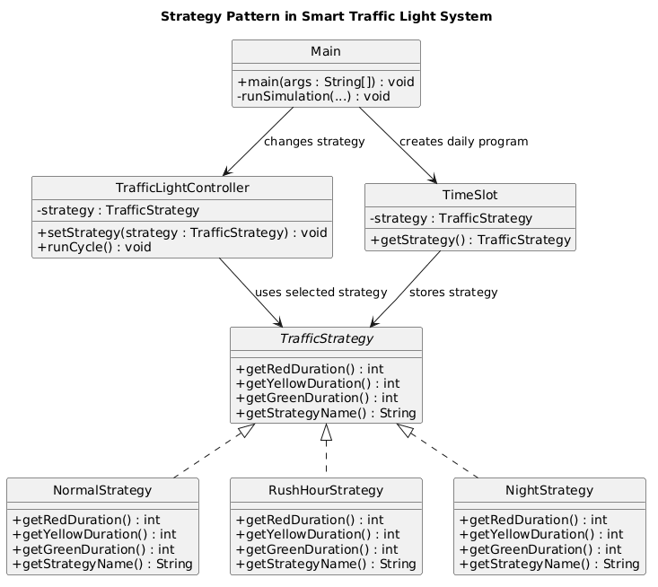
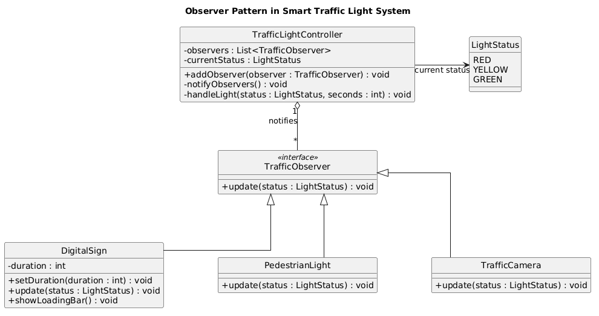
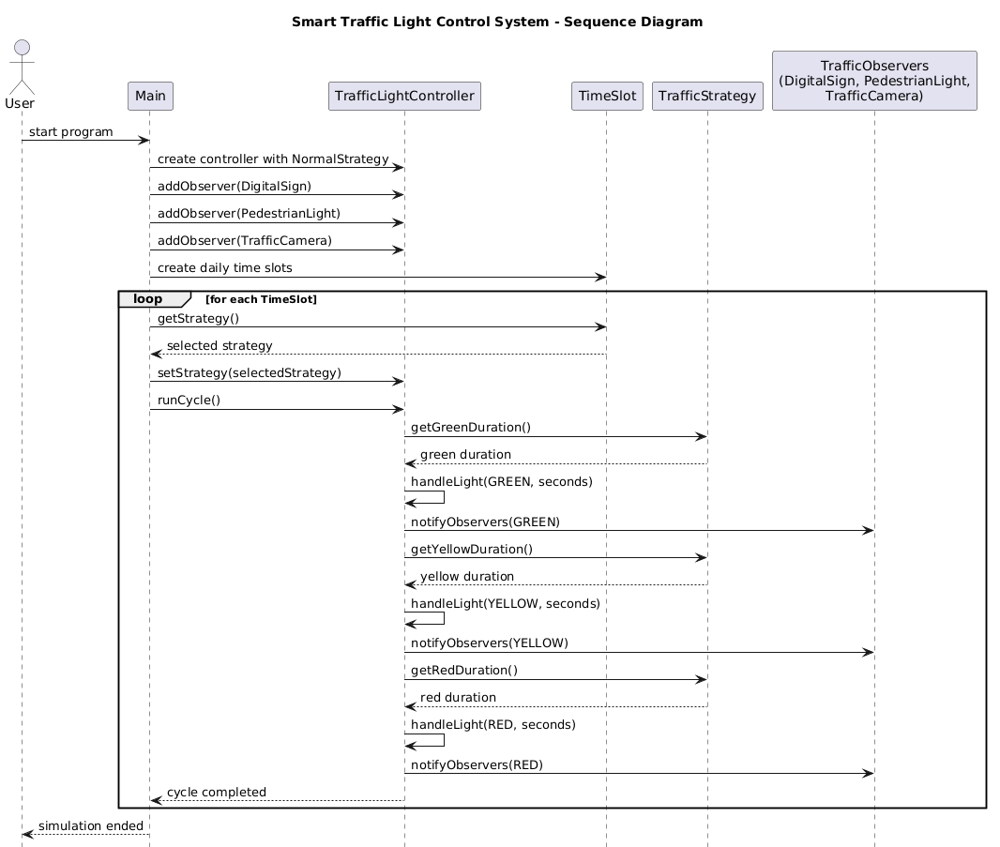
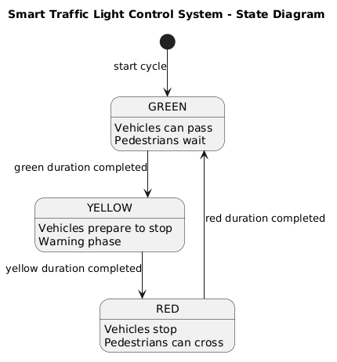
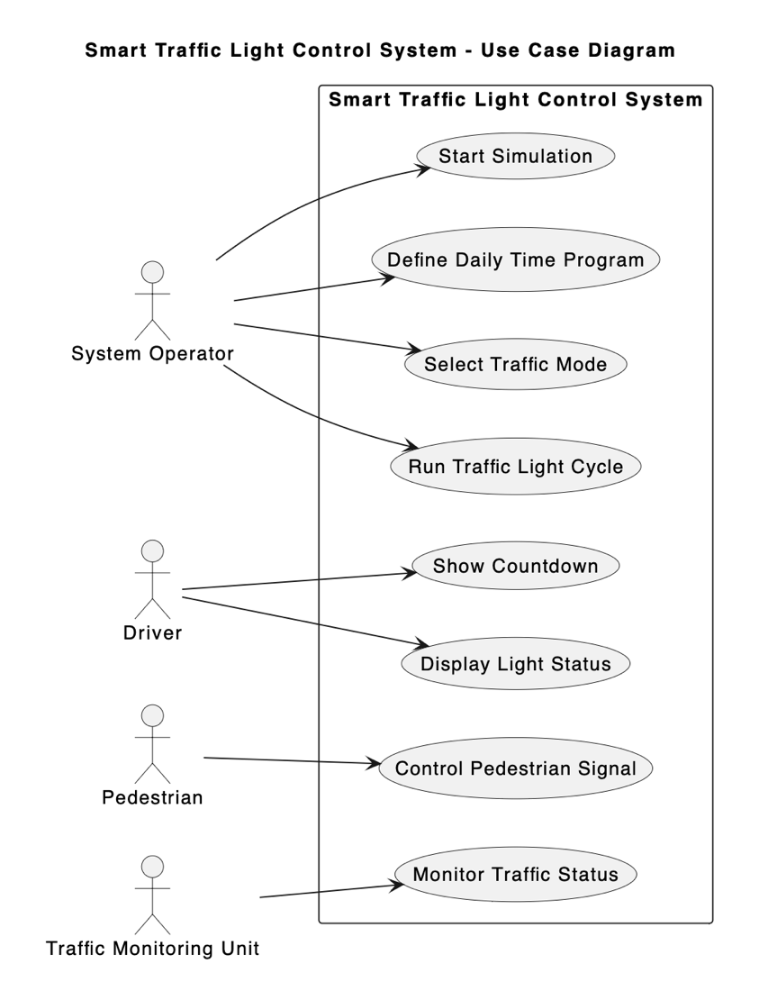

# Smart Traffic Light Control System

A console-based Java simulation of a traffic light that **changes its timing by time of day** and **notifies connected devices** whenever the light changes. The project demonstrates two classic design patterns working together:

- **Strategy Pattern:** timing rules for normal hours, rush hours and night are interchangeable strategy classes.
- **Observer Pattern:** a digital sign, a pedestrian light and a traffic camera react to every light change independently.

Course project for **SEN3006 Software Architecture**, Bahçeşehir University.

## The problem

Traffic density changes during the day, so a fixed red/yellow/green timing doesn't fit every hour. If every timing rule and every device call lives inside one controller class, the controller fills up with `if/else` blocks and has to be edited each time a new mode or device is added.

**Goal:** a controller that adapts to different time periods and informs multiple components without growing in complexity.

## Design

### Strategy Pattern: interchangeable timing

`TrafficLightController` only runs the green → yellow → red cycle. The durations come from whichever `TrafficStrategy` is active:

| Strategy | Green | Yellow | Red |
|---|---|---|---|
| `NormalStrategy` | 5 s | 3 s | 5 s |
| `RushHourStrategy` | 8 s | 2 s | 3 s |
| `NightStrategy` | 7 s | 3 s | 3 s |

A new mode (e.g. *weekend* or *emergency*) is just a new class implementing `TrafficStrategy`; the controller doesn't change (Open/Closed Principle).



### Observer Pattern: decoupled notifications

The controller keeps a list of `TrafficObserver`s and calls `update(status)` on each one when the light changes:

- `DigitalSign` shows the status and a live countdown bar for drivers.
- `PedestrianLight` gives pedestrians the opposite signal (cars green → pedestrians wait).
- `TrafficCamera` turns violation monitoring on for red and off for green.



### Daily time program

`TimeSlot` binds a time range to a strategy. `Main` defines a full day:

```
00:00 - 06:00  NIGHT MODE
06:00 - 09:00  RUSH HOUR MODE
09:00 - 16:00  NORMAL MODE
16:00 - 20:00  RUSH HOUR MODE
20:00 - 00:00  NORMAL MODE
```

`TimeSlot.isActive()` converts times to minutes since midnight and handles **slots that cross midnight** (e.g. 22:00–03:00) separately. Without that check, a simple `start <= now < end` comparison fails for those slots.

## Demo

The program runs in two modes:

1. **Simulation mode:** runs one full cycle for each time slot of the day.
2. **Real-time mode:** reads the system clock, picks the matching time slot and runs that cycle.

Sample output:

```
Time Zone: 00:00 - 06:00 [NIGHT MODE]

--- NIGHT MODE ---
    Green: 7s  |  Yellow: 3s  |  Red: 3s
---------------------------------------

>> GREEN LIGHT (7s)
[Traffic Light] Status: GREEN - Please observe all traffic regulations.
[Pedestrian Light] Status: RED - Please wait.
[Camera] Green traffic light! Passage allowed, recording off.
[Traffic Light] [░░░░░░░░░░░░░░░░░░░░] 7s left.
[Traffic Light] [███████████░░░░░░░░░] 3s left.
[Traffic Light] [████████████████████] 0s left.

>> RED LIGHT (3s)
[Traffic Light] Status: RED - Please observe all traffic regulations.
[Pedestrian Light] Status: GREEN - Safe to cross.
[Camera] Red traffic light! Violation monitoring enabled.
...
[NIGHT MODE] Cycle Completed.
```

## How to run

You need JDK 8 or newer.

```bash
git clone https://github.com/senasagdc/softwarearchitecture-traffic-light-control.git
cd softwarearchitecture-traffic-light-control
javac -d out src/trafficlight/*.java
java -cp out trafficlight.Main
```

Countdowns run in real seconds, so a full run takes about 1.5 minutes.

## UML diagrams

| Sequence | State |
|---|---|
|  |  |

<details>
<summary>Use case diagram</summary>



</details>


## Project structure

```
src/trafficlight/
├── Main.java                    # builds the system, defines the daily program, runs both modes
├── TrafficLightController.java  # runs the light cycle, holds the strategy, notifies observers
├── TimeSlot.java                # time range → strategy, midnight-aware isActive()
├── LightStatus.java             # RED, YELLOW, GREEN
├── TrafficStrategy.java         # Strategy interface
├── NormalStrategy.java
├── RushHourStrategy.java
├── NightStrategy.java
├── TrafficObserver.java         # Observer interface
├── DigitalSign.java             # status message + countdown bar
├── PedestrianLight.java
└── TrafficCamera.java
docs/uml/                        # class, sequence, use case and state diagrams
```

## Known limitations & possible improvements

- **Countdown breaks the observer abstraction.** `TrafficLightController.runCountdown()` checks `instanceof DigitalSign` to drive the countdown bar, so the controller still knows about one concrete observer. A cleaner design would pass the duration through the observer interface, e.g. `update(status, seconds)`.
- **No automated tests.** The system is checked by running `Main`. Unit tests for `TimeSlot.isActive()` (especially midnight-crossing slots) and for the controller with a mock observer would be the next step.
- **Blocking timing.** `Thread.sleep()` makes the simulation slow and hard to test. An injectable clock, or a scheduler, would let tests run instantly.
- **Hard-coded schedule.** The daily program and durations live in code. They could be loaded from a config file, or chosen automatically from real traffic data (e.g. the camera feeding a density-based strategy).

